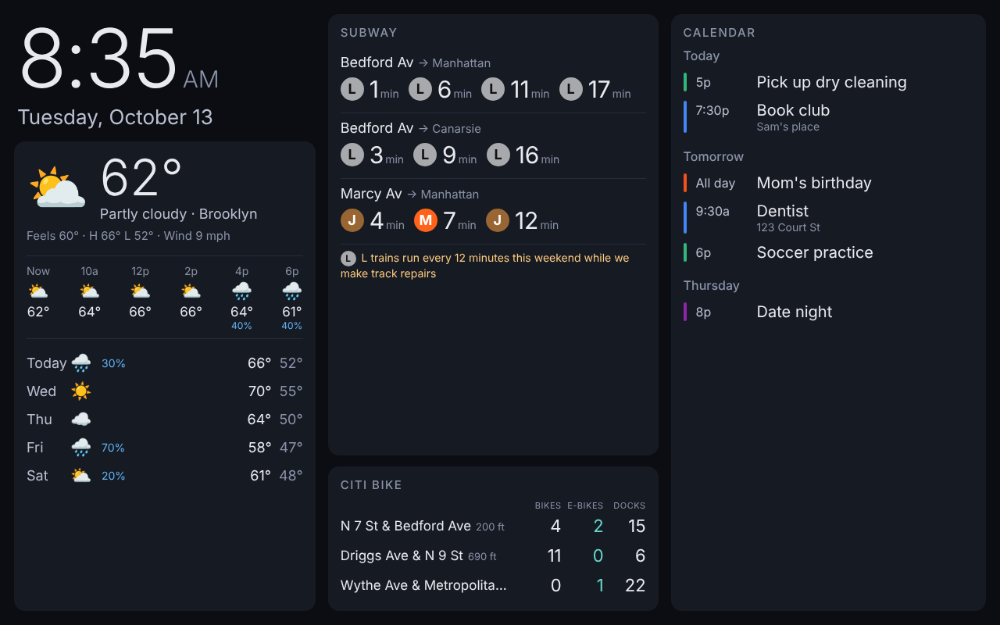

# Picture frame dashboard

A wall dashboard for an **AiMOR PF1007 10.1" Wi-Fi photo frame** (FCC ID 2AW9M-PORTRAIT), based on
[wesbos/photo-frame-dashboard](https://github.com/wesbos/photo-frame-dashboard). It shows:

- **Weather**: current conditions, the next 12 hours and a 5-day forecast ([Open-Meteo](https://open-meteo.com), no API key)
- **Subway times**: live MTA arrivals for the platforms you choose, plus service alerts for those lines (MTA GTFS-realtime, no API key)
- **Citi Bike**: classic bikes, e-bikes and open docks at your nearest stations (Citi Bike GBFS, no API key)
- **Google Calendar**: today's agenda and the next few days, from one or more calendars (secret iCal link)



There are two halves:

1. **Rooting the frame** so it runs your page instead of the AiMOR app. This happens at a computer
   with the frame plugged in over USB. See **[docs/ROOTING-PF1007.md](docs/ROOTING-PF1007.md)**.
2. **This server**, which runs on an always-on machine on your home network (a Raspberry Pi, a
   home server or an old laptop). It fetches all the data and serves the page the frame shows.

## Why a small home server?

The frame runs Android 6 with an old WebView and an old certificate store. Many modern HTTPS
sites fail on it, including anything with a Let's Encrypt certificate. So the frame talks only
to this server over plain HTTP on your LAN, and the server does all the modern HTTPS work.
That also keeps your private Google Calendar link off the frame.

The page is written in ES5 with flexbox only, so it should render on the stock WebView without the
WebView upgrade. That's how it was written, not something tested on a real frame yet. If anything
looks broken on the frame, do the WebView 106 upgrade from the rooting guide.

## Quick start

Needs Node.js 18 or newer.

```sh
npm install
npm run demo          # sample data, nothing to configure: open http://localhost:8080
```

Then configure it for real:

```sh
cp config.example.json config.json
cp .env.example .env
npm test
npm start
```

`npm start` prints the address to point the frame at, for example `http://192.168.1.20:8080`.
Give that machine a fixed IP (a DHCP reservation in your router) so the address never changes.

## Configuration (`config.json`)

### Weather

Set `weather.latitude` / `weather.longitude` to your home, and `label` to whatever you want shown.
`units` is `imperial` or `metric`.

### Subway

Each entry in `subway.stops` is one **platform direction**:

```json
{ "label": "Bedford Av", "direction": "Manhattan", "stopId": "L08N", "routes": ["L"] }
```

Find stop IDs with:

```sh
npm run find-stop -- bedford
```

IDs ending in `N` are northbound (usually toward Manhattan or the Bronx) and `S` southbound.
`routes` picks which MTA feeds to download, and only those lines are shown. Leave it out to check
every feed. Express runs (the `<6>`, `<7>`) show as diamonds. Set `"alerts": false` to hide
service alerts.

### Citi Bike

Either list exact stations:

```sh
npm run find-station -- bedford             # search by name
npm run find-station -- 40.7081 -73.9571    # nearest to a point
```

```json
"citibike": { "stationIds": ["<id printed by find-station>"] }
```

or leave `stationIds` empty and use `near` to show the closest `count` stations to a point.

### Google Calendar

For each calendar: open Google Calendar on a computer → **Settings** → click the calendar →
**Integrate calendar** → copy **Secret address in iCal format**. Put it in `.env`:

```sh
GCAL_FAMILY_ICS=https://calendar.google.com/calendar/ical/.../private-.../basic.ics
```

and refer to it from `config.json` as `"url": "$GCAL_FAMILY_ICS"`. Add one entry per calendar,
each with its own `color`. The secret address works like a password: anyone who has it can read
the calendar. If it leaks, reset it on the same settings page.

Recurring events, exceptions, moved and cancelled instances, all-day and multi-day events are
handled. Google can take a few hours to update the secret iCal feed after you change an event.
That delay is on Google's side, not the dashboard's.

### Other options

| Setting | Default | |
| --- | --- | --- |
| `port` | `8080` | Also `PORT` env var |
| `timezone` | `America/New_York` | Used for the clock and calendar, whatever the frame's own clock says |
| `?nightStart=23&nightEnd=6` | 23 → 6 | URL query: hours when the screen dims |

Data is cached on the server: subway 30 s, Citi Bike 60 s, calendar 5 min, weather 10 min. If a
source fails, the last good data stays on screen with a note.

## Running it permanently

**Raspberry Pi / Linux:** `deploy/frame-dashboard.service` is a systemd unit. Edit the paths in it,
then run `sudo systemctl enable --now frame-dashboard`.

**Docker:**

```sh
docker build -t frame-dashboard .
docker run -d --restart unless-stopped -p 8080:8080 \
  -v "$PWD/config.json:/app/config.json:ro" --env-file .env frame-dashboard
```

**Testing without a server:** with the frame on USB and root ADB working, `adb reverse tcp:8080 tcp:8080`
lets the frame open `http://127.0.0.1:8080/` from your laptop (see the rooting guide).

## Layout

```
server/            Node server (no framework)
  sources/         weather, subway, citibike, calendar
  ics.js           iCalendar parser + recurrence expansion
public/            The page the frame shows (ES5, flexbox only, for the old WebView)
scripts/           find-stop / find-station helpers
test/              node --test suites (npm test)
docs/              Rooting guide for the PF1007
```
